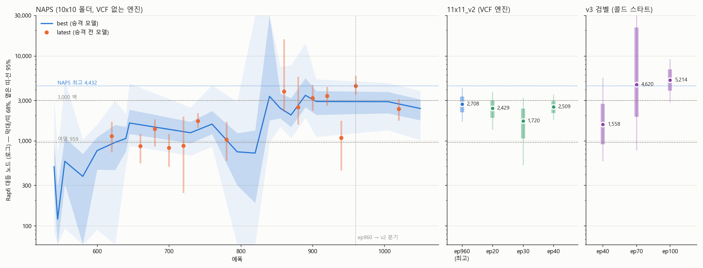

# 메기 리그(CATFISH): 판단을 일부러 끈 자기 복사본으로 자가대국의 과신을 깨는 방법

**— 노트북 한 대로 학습한 11×11 오목 AI의 사례 보고 —**

배성훈 (대구고등학교 시카모어)
작성: 2026년 10월 23일 · 연구 보고서 (논문 형식 초안)

---

## 요약

자가대국 강화학습으로 보드게임 AI를 만들 때, 가치망(판세를 예측하는 신경망)은 정책망(다음 수를 고르는 신경망)보다 훨씬 다루기 어렵다. 가치망의 학습 신호는 판 끝의 승패 하나뿐이어서 성기고 시끄러우며, 탐색은 가치망의 판단을 믿고 가지를 쳐 내므로 가치망의 오류가 탐색 전체를 끌고 간다. 여기에 자가대국은 같은 신경망끼리 두기 때문에, 한 모델이 가진 착각을 상대도 똑같이 가진다. 착각이 대국 결과로 드러나지 않으니 교정되지도 않는다. 우리는 이 현상을 "유전병"이라 불렀다.

이 보고서는 이 문제를 겨냥해 우리가 고안한 **메기 리그(CATFISH, Crippled Anchors To Fight Inbred Self-play Habits)**를 소개한다. 메기는 현재 신경망을 복사한 뒤 판단 기능 하나를 일부러 끈 상대다. 가치망 출력을 0으로 만든 "가치망 0 메기", 절반으로 줄인 "가치망 절반 메기", 정책 출력을 균등하게 만든 "정책 0 메기"가 있다. 본 모델은 자가대국의 일부를 이 메기들과 두고, 그 판에서 자기 쪽 수와 최종 승패만 학습한다. 메기는 매 에폭 현재 모델에서 새로 만들어지므로 따로 학습할 필요가 없고, 난도가 본 모델과 함께 자란다.

메기는 실패에서 출발했다. 2026년 9월 27일 가치망 라벨 오염으로 가치망을 초기화해야 했고, 10월 12일 그 문제의 크기를 재려던 "가치망 제거 실험"에서 가치망을 끈 모델이 원본이 0/3으로 못 풀던 최난도 문제를 3/3으로 풀었다. 우리는 이 진단 도구를 처방으로 뒤집었다. 판단을 끈 모델 자체를 연습 상대로 쓰는 것이다.

GTX 1050 노트북 한 대에서 처음부터 다시 학습한 v3(검벨 알파제로 + 보조 목표 + 메기)는 시작 약 8시간, 100 에폭 만에 Rapfi 엔진 기준 대등점 5,214노드(부트스트랩 68% 구간 3,898~6,927)에 도달했다. 이는 약 한 달간 학습한 이전 계보의 최고 기록(4,432)보다 높은 점 추정이다. 전술 문제 채점에서도 역대 최고인 10문제 중 9문제를 통과했고, 메기 투입 전 과신으로 틀리던 문제(이길 판을 놓치는 p17)를 3/3으로 풀었다. 메기 투입 전 상승하던 가치 손실(0.173 → 0.191)은 투입 후 꾸준히 내려갔다(0.173 → 0.133).

다만 이 결과는 메기 없는 대조 실험을 거치지 않았으므로, 성과 전체를 메기의 효과로 단정할 수는 없다. 이 보고서는 메기의 설계, 기원, 관찰된 증거, 관련 연구와의 차이, 그리고 한계와 검증 계획을 정리한다.

**주요어:** 자가대국 강화학습, 알파제로, 가치망 과신, 리그 학습, 오목, 저자원 학습

---

## 1. 서론

### 1.1 배경: 알파고 10년

2016년 3월 13일, 이세돌 9단은 알파고와의 제4국 78수로 승리했다. 그 수 직후 알파고는 자기가 유리하다고 계속 믿다가 무너졌다. 판세를 판단하는 신경망이 처음 보는 국면에서 근거 없이 확신한 것이다. 10년이 지난 2026년, 우리는 노트북 한 대로 오목 AI를 만들면서 같은 현상을 여러 번 만났다. 우리 AI 역시 질 판을 이긴다고 확신했다.

딥마인드는 알파고(2016, 사람 기보 지도학습 후 강화학습), 알파고 제로(2017, 외부 데이터 없는 자가대국과 게이트), 알파제로(2018, 게이트 없는 단일 모델 자가대국)로 이어지며 사람의 데이터 없이 사람을 넘는 방법을 보였다. 그러나 이 성과는 거대한 계산 자원 위에 서 있다. 알파제로는 1세대 TPU 5,000개로 자가대국을 생성했고, 우리 장비인 GTX 1050 한 개와 비교하면 계산 능력은 약 25만 분의 1이다.

### 1.2 문제: 작은 장비에서 가치망의 과신

장비가 작으면 자가대국 판 수가 적고, 신경망도 작아야 한다. 이 조건에서 가장 크게 드러난 문제는 가치망의 과신이었다.

- **신호가 성기다.** 정책망은 매 수마다 탐색 결과라는 촘촘한 정답을 받는다. 가치망은 판 끝의 승패 하나를 그 판의 모든 국면이 나눠 갖는다. 중간의 실수 하나가 앞 국면 전체의 판단을 오염시킨다.
- **오류가 증폭된다.** 정책망이 틀리면 좋은 수를 늦게 찾을 뿐이다. 가치망이 틀리면 탐색이 그 판단을 믿고 가지를 잘라 버린다. 틀린 판단이 탐색 전체를 끌고 가고, 그 탐색 결과로 다시 가치망을 학습한다. 오염이 되먹임 고리가 된다.
- **자가대국은 착각을 공유한다.** 같은 신경망끼리 두면 한쪽이 과신하는 국면에서 다른 쪽도 같은 판단을 한다. 그 국면은 대국에서 실제 패배로 드러나지 않으므로 교정 신호가 생기지 않는다.

장비가 크면 판 수와 탐색량으로 이 문제를 어느 정도 덮을 수 있다. 장비가 작으면 덮을 수 없다.

### 1.3 제약: 순수성

이 프로젝트는 처음부터 학습에 외부 데이터를 넣지 않는다는 원칙을 지키려 했다. 측정에는 강한 오목 엔진 Rapfi를 쓰지만, Rapfi의 수나 평가를 학습 데이터로 쓰지는 않는다. Rapfi 데이터로 가치망을 가르치면 과신을 쉽게 교정할 수 있었겠지만, 우리는 그 길을 택하지 않았다. 그러면 남는 질문은 하나다.

> 바깥의 도움 없이, 자기 자신만으로 과신을 깰 수 있는가?

메기 리그는 이 질문에 대한 답이다. 바깥에서 상대를 데려올 수 없으니, 자기 안에서 상대를 만든다.

### 1.4 기여

1. 현재 모델의 판단 기능 일부를 끈 복사본을 매 에폭 새로 만들어 연습 상대로 쓰는 **메기 리그**를 제안한다. 추가 학습이 필요 없고, 외부 데이터를 쓰지 않으며, 알파제로 계열 어디에나 붙일 수 있고, 상대의 난도가 본 모델과 함께 자란다.
2. 메기의 기원이 된 **가치망 제거 실험**을 보고한다. 가치망을 끈 모델이 원본이 못 풀던 문제를 푼다는 관찰이다.
3. 노트북 한 대에서 처음부터 학습한 v3에 메기를 적용한 **사례**를 보고한다. 외부 엔진 기준 대등점, 전술 문제, 가치 손실, 메기 대국 결과를 함께 제시한다.
4. 관련 연구(과거 모델 리그, 알파스타 익스플로이터, KataGo 적대적 공격 연구 등)와 비교해 메기의 위치를 정리하고, 대조 실험 계획을 포함한 **한계**를 밝힌다.

---

## 2. 관련 연구

### 2.1 자가대국과 게이트

알파고 제로는 새 모델이 이전 최고 모델을 상대로 55% 이상 이길 때만 교체하는 게이트를 썼다. 알파제로는 게이트를 없애고 항상 최신 모델로 자가대국을 생성했다. 우리 계보도 같은 순서를 밟았다. NAPS 계열은 게이트를 썼고, 게이트에 패배 음수 가중치를 주는 변형(음수 게이팅)과 외부 엔진 래더를 더한 2단계 승격까지 시도했다. 그러나 대등점 3,000노드 근처의 정체를 겪은 뒤, v3에서는 게이트를 없앴다.

### 2.2 과거 모델 리그

알파고의 강화학습 단계는 과거 정책들의 풀에서 상대를 골랐다. 알파스타는 이를 대규모 리그로 키웠다. 2026년 Tablut 재현 연구도 학습 대국의 25%를 과거 체크포인트와 두게 했다. 과거 모델 리그는 망각을 줄이고 상대 다양성을 준다. 그러나 과거 모델은 시간이 지날수록 너무 쉬운 상대가 되고, 어떤 체크포인트를 남기고 뺄지 계속 관리해야 한다. 2026년 Big 2 연구는 현재 정책과의 자가대국이 과거 체크포인트 리그보다 성능이 좋았다고 보고하며, 상대가 학습자와 비슷한 실력이어야 지금 중요한 실수가 드러난다고 해석했다.

### 2.3 익스플로이터와 적대적 상대

알파스타의 익스플로이터는 주 에이전트의 약점을 찌르도록 따로 학습한 상대다. 효과적이지만 별도 학습 체계와 계산 자원이 든다. 2022~2024년 FAR AI 연구진은 약한 적대적 정책이 초인적 바둑 AI KataGo를 이길 수 있음을 보였다. KataGo가 특정 모양에서 판세를 잘못 읽는 약점을 찌른 것이다. KataGo는 적대적 국면에서 자가대국을 시작하는 방식으로 이 공격을 막았지만, 후속 연구(AAAI 2025)에서는 공격자를 다시 학습시키면 방어가 다시 뚫렸다.

### 2.4 개체군 기반 학습

Sample Factory나 위험 선호 다양화 연구 같은 개체군 기반 학습은 강한 에이전트를 복사한 뒤 하이퍼파라미터에 잡음을 넣어 다양성을 만든다. 복사와 변형이라는 점은 메기와 닮았지만, 변형 대상이 하이퍼파라미터이고 목적이 탐색 다양성이다.

### 2.5 가치망의 과신과 사각지대

2022년 공평 게임 연구는 강한 사전 정책이 근거 없이 확신하면 탐색이 돌이킬 수 없는 나쁜 수순으로 빠진다고 지적했다. 체스 엔진 Leela Chess Zero가 백만 노드 이상 탐색하고도 강제 메이트를 놓친 사례를 "사각지대"로 들었다. 우리가 본 현상과 같은 문제를 짚었지만, 처방은 제시하지 않았다.

### 2.6 메기의 위치

| 방법 | 상대 | 학습 비용 | 난도 조절 | 겨냥하는 것 |
|---|---|---|---|---|
| 과거 모델 리그 | 예전 체크포인트 | 없음 | 점점 쉬워짐, 수동 관리 | 망각, 다양성 |
| 익스플로이터 (알파스타) | 따로 학습한 적대 모델 | 큼 | 자동이지만 비쌈 | 주 모델의 약점 |
| 적대적 국면 주입 (KataGo) | 적대 모델이 찾은 국면 | 적대 모델 학습 필요 | 이미 찾은 공격에 한정 | 특정 공격 |
| 개체군 기반 학습 | 하이퍼파라미터를 바꾼 복사본 | 개체군 유지 비용 | 자동 | 탐색 다양성 |
| **메기 리그 (이 연구)** | **현재 모델에서 판단 일부를 끈 복사본** | **없음** | **자동 (매 에폭 재생성)** | **가치망의 과신** |

우리는 2026년 10월 22~23일 두 차례 문헌을 조사했다. "현재 모델의 특정 판단 기능을 제거한 복사본을 매 에폭 연습 상대로 쓰는" 방식은 조사 범위 안에서 찾지 못했다. 다만 웹 검색은 주요 논문과 공개 자료만 덮으므로, 워크숍 논문이나 게임 AI 개발 커뮤니티에 비슷한 시도가 있을 가능성은 남아 있다. 따라서 "최초"라고 단정하지 않고 "조사 범위에서 찾지 못했다"고 적는다.

---

## 3. 기원: 실패, 실험, 방법

메기는 계획된 기법이 아니었다. 세 단계를 거쳐 나왔다.

### 3.1 실패: 가치망 오염 (2026년 9월 26~27일)

NAPS 2차 런 370 에폭 무렵, 가치 라벨에 오염(Hard-7 라벨)이 섞인 것이 발견됐다. 오염된 라벨을 제거했지만 이미 학습된 가치망은 돌아오지 않았고, 408 에폭에 가치망 머리만 초기화했다. 이때 "가치망이 틀리면 전체가 끌려간다"는 것을 처음 직접 겪었다. 이후에도 과신은 반복됐다. 축전에서 사람에게 진 판을 문제로 만들어 보면, 모델은 질 판에서 판세를 +0.8 이상으로 확신하고 있었다.

### 3.2 실험: 가치망 제거 (2026년 10월 12일)

계보 최고 모델 NAPS-960(대등점 약 4,432)이 풀지 못하는 문제들이 있었다. 이 실패가 가치망 때문인지 정책망 때문인지 가리기 위해, 채점할 때만 가치망 출력에 배율을 곱해 같은 6문제를 풀렸다. 배율 1은 원래 모델, 0은 가치망 없음, 0.5는 절반이다. 학습에는 아무것도 넣지 않는 측정 전용 실험이었다.

**표 1. 가치망 제거 실험 (NAPS-960, 문제당 3회 시도, 탐색 900/1,100/1,300회)**

| 문제 | 원래 (×1) | 가치 0 | 가치 ×0.5 |
|---|---|---|---|
| 구석 대각선 | 1/3 | 0/3 | 0/3 |
| 3단계 p35 | 0/3 | 0/3 (나쁜 수는 피함, 900회에서 정답) | 0/3 |
| 조용한 열린3 | 0/3 | 1/3 | 1/3 |
| 3단계 p50 | 0/3 | 0/3 | 0/3 |
| 13수 필패 직전 | 3/3 | 3/3 | 3/3 |
| **2단계 p18 (Rapfi 수비 2만 노드 필요)** | **0/3** | **3/3** | **0/3** |

탐색 전 신경망 값을 보면 과신이 분명했다. 구석 대각선 문제에서 가치망은 +0.99, 3단계 p35에서는 +0.71로 자기가 이긴다고 봤다. 실제로는 두 문제 모두 지는 국면이었다.

이 실험에서 네 가지가 드러났다.

1. **가치망이 긴 수비를 해친다.** p18의 첫 수는 원래 모델과 가치 0 모델이 같았다. 차이는 그 뒤 40수 수비에서 났다. 가치망 없이 정책망만 따라간 쪽이 끝까지 버텼다.
2. **깊은 수읽기에 가치망이 꼭 필요한 것은 아니었다.** 13수 문제는 가치망 없이도 3/3이었다.
3. **과신은 조금만 남아도 해롭다.** 배율 0.5에서는 p18이 다시 0/3이었다.
4. **정책망의 맹점은 따로 남는다.** 구석 대각선과 p50은 어느 조건에서도 실패했다. 정답이 정책 후보에 거의 없었다.

결론은 "유전병 = 가치망의 과신 + 정책망의 맹점"이었다.

### 3.3 방법: 진단 도구를 처방으로 (2026년 10월 18일)

보통이라면 이 결과에서 "가치망이 문제니 고치자"로 끝났을 것이다. 우리는 다르게 읽었다.

> 판단을 끈 모델은 원본과 **다른 것을 본다.** 그렇다면 그 모델은 원본의 맹점을 드러내는 상대가 될 수 있다.

자가대국에서는 본 모델과 상대가 같은 착각을 공유한다. 판단을 끈 상대는 그 착각을 공유하지 않는다. 본 모델이 "이 국면은 유리하다"고 믿고 느슨하게 두면, 가치망을 끈 상대는 그 판단에 끌려가지 않고 다른 수를 둔다. 그 결과 본 모델이 실제로 지면, 그 패배가 학습 데이터가 되어 과신을 교정한다.

이것이 메기 리그다. 이름은 "메기 효과"에서 왔다. 미꾸라지 수조에 메기를 넣으면 미꾸라지들이 더 활발해진다는 이야기다. CATFISH는 사용자가 붙인 역두문자어로, Crippled Anchors To Fight Inbred Self-play Habits(근친 자가대국의 습관과 싸우는 불구 앵커)의 머리글자다.

---

## 4. 방법

### 4.1 메기 만들기

메기는 현재 신경망을 복사한 뒤 마지막 출력층 하나를 바꿔 만든다. v3 학습 코드의 해당 부분은 다음과 같다.

```python
CATFISH = ("value0", "value_half", "policy0")

def make_catfish(model):
    out = []
    for kind in CATFISH:
        c = copy.deepcopy(model).eval()
        with torch.no_grad():
            if kind == "value0":        # 판세 판단 끄기: 가치 출력 = 0
                c.value_head[6].weight.zero_(); c.value_head[6].bias.zero_()
            elif kind == "value_half":  # 판세 판단 절반
                c.value_head[6].weight.mul_(0.5); c.value_head[6].bias.mul_(0.5)
            else:                       # 수 감각 끄기: 정책 = 균등 분포
                c.policy_head[4].weight.zero_(); c.policy_head[4].bias.zero_()
        out.append(c)
    return out
```

**표 2. 메기의 종류**

| 메기 | 바꾸는 곳 | 효과 | 본 모델에게 주는 것 |
|---|---|---|---|
| 가치망 0 | 가치 머리 마지막 층 가중치·편향 = 0 | 모든 국면의 가치가 0 (tanh(0) = 0). 탐색이 승패 판단 없이 정책과 방문 수로만 진행 | 판세만 믿고 두는 수의 허점을 찌름 |
| 가치망 절반 | 같은 층 ×0.5 | 판세 판단이 원래보다 덜 확신함 | 비슷한 실력에서 미묘한 과신을 찌름 |
| 정책 0 | 정책 머리 마지막 층 = 0 | 사전 확률이 모든 칸에 균등. 탐색이 수 감각 없이 진행 | 엉뚱한 수에도 판세를 바로 읽는지 확인 (쉬운 상대) |

처음에는 사용자가 머리를 "초기화"하자고 했다. 하지만 무작위 초기화는 의미 없는 잡음을 만들 뿐이라, 기능을 중립값으로 끄는 방식(0 또는 균등)을 택했다.

### 4.2 학습 루프에 넣기 (v3)

v3는 에폭마다 192판을 둔다. 그중 144판은 본 모델끼리의 자가대국이고, 48판은 메기 세 마리와 각각 16판씩이다. 메기 대국의 절반은 본 모델이 흑(선수)이다.

- **본 모델 쪽:** 자가대국과 똑같이 검벨 알파제로 루트 탐색(정밀 200회, 빠른 48회)으로 둔다. 정밀 탐색한 수(약 25%)만 학습 데이터로 기록한다.
- **메기 쪽:** 일반 PUCT 탐색으로 두며, 메기의 수는 기록하지 않는다. 메기의 수를 정답으로 배우면 일부러 망가뜨린 판단을 배우게 되기 때문이다.
- **가치 목표:** 메기 대국에서도 본 모델 쪽 국면의 가치 목표는 0.8 × (최종 승패) + 0.2 × (탐색 가치)다. 본 모델이 유리하다고 믿던 국면에서 실제로 졌다면, 그 기록이 가치망을 끌어내린다.
- **재생성:** 메기는 매 에폭 시작할 때 그 시점의 본 모델에서 새로 만든다. 디스크에 저장하지 않고 메모리에서 복사한다.

이렇게 메기는 **가치망의 보조 학습 장치**로 작동한다. 정책을 가르치는 상대가 아니라, 가치망이 볼 국면을 바꾸는 장치다. KataGo식 보조 목표(상대 다음 수, 최종 영역)가 신경망 안에서 "무엇을 배울지"를 바꾼다면, 메기는 대국 데이터 쪽에서 "어떤 국면을 볼지"를 바꾼다.

### 4.3 고정 메기와 재생성 메기

메기는 두 형태로 쓰였다.

| 형태 | 사용처 | 만드는 시점 | 특징 |
|---|---|---|---|
| 고정 메기 | 15×15 3차 런(ep46~), 11×11 v2 | 최고 모델에서 한 번 만들어 파일로 저장. 승격 후 수동으로 다시 만듦 | 리그의 고정 앵커. 시간이 지나면 상대적으로 약해짐 |
| 재생성 메기 | 11×11 v3 (ep79~) | 매 에폭 현재 모델에서 자동 생성 | 난도가 본 모델과 함께 자람. 관리 불필요 |

v3의 재생성 방식은 게이트가 없는 알파제로식 학습과 자연스럽게 맞는다. 승격 시점이 없으니 "언제 메기를 다시 만들지"를 정할 필요도 없다.

### 4.4 메기의 다섯 가지 성질

1. **간단하다.** 복사 후 출력층 하나를 0 또는 0.5로 만들면 끝이다. 몇 줄이면 구현된다.
2. **값싸다.** 따로 학습할 게 없다. 자가대국의 일부(v3에서 25%)를 메기 대국으로 바꿀 뿐이다.
3. **범용적이다.** 정책망과 가치망이 있는 알파제로 계열이면 게임과 상관없이 붙일 수 있다. 게임 지식이 필요 없다.
4. **난도가 저절로 조절된다.** 현재 모델에서 만들므로 항상 "본 모델보다 한 기능만 약한" 상대다. 끄는 기능에 따라 쉬운 상대(정책 0)부터 약점을 찌르는 상대(가치망 0)까지 층도 저절로 생긴다.
5. **순수하다.** 외부 데이터도 외부 엔진도 학습에 들어가지 않는다.

---

## 5. 실험 환경

### 5.1 장비

- GPU: NVIDIA GTX 1050 (노트북). 자가대국 추론과 학습을 같은 GPU에서 수행.
- 같은 GPU에서 측정(Rapfi 래더, 전술 문제 채점)도 함께 돌린다.

### 5.2 v3 설정

| 항목 | 값 |
|---|---|
| 신경망 | 잔차 신경망 128채널 × 8블록, 약 271만 파라미터. 정책, 가치, 생존 머리 + 보조 머리 2개(상대 다음 수, 최종 칸 점유). 무작위 초기화 |
| 탐색 | 검벨 알파제로 루트(후보 16개, 연속 반감), C++ 구현. 정밀 200회 / 빠른 48회, 정밀 확률 0.25 |
| 전술 보조 | VCF(연속 4목 승리) 확인 깊이 10, 노드 예산 3,000. 포크 입력면 |
| 학습 | 에폭당 192판(자가대국 144 + 메기 48, ep79부터), AdamW 1e-3, 배치 256, 창 30만 행 |
| 가치 목표 | 0.8 × 최종 승패 + 0.2 × 탐색 가치 |
| 손실 가중치 | 상대 다음 수 0.15, 최종 점유 0.15, 생존 0.1 |
| 게이트 | 없음 (항상 최신 모델) |
| 외부 데이터 | 없음 |
| 시작 | 2026년 10월 22일 14:52, 메기 투입 20:59(79 에폭) |

### 5.3 측정 방법

**Rapfi 래더와 대등점.** Rapfi는 공개된 강한 오목 엔진이다. 탐색 노드 수를 제한해 실력을 조절할 수 있다. 우리 모델(탐색 1,100회, 잡음 없음)을 노드 수가 다른 여러 Rapfi와 20판씩 두게 하고, 점수를 Elo로 바꿔 로그 노드 수에 대한 직선으로 맞춘다. 점수가 50%가 되는 노드 수를 **대등점**이라 부른다. 판을 다시 뽑는 부트스트랩(4,000회)으로 68%, 95% 구간을 구한다. 10월 11일 검증에서 NAPS-920을 자기 대등점(3,388노드)의 Rapfi와 직접 40판 두게 했더니 51.2%(95% ±14.5)가 나왔다. 래더의 대등점이 실제 대국 결과와 맞는다는 근거다.

**Elo 환산.** 대등점을 Rapfi 100노드 = 0, 노드 10배 = 304 Elo(v3 100 에폭 래더에서 맞춘 기울기)로 바꿔 함께 보고한다.

**전술 문제 채점.** 실제로 진 판(웹 대국, 축전, Rapfi 대국)에서 결정적 실수 직전 국면을 뽑아 문제로 만들었다. 모델이 문제 국면에서 Rapfi(100만 노드)를 상대로 끝까지 두어 지지 않으면 통과다. 탐색 900/1,100/1,300회로 세 번 시도해 두 번 이상 통과하면 그 문제를 통과한 것으로 친다. 단계 구조는 다음과 같다.

- 1단계(졸업 문제): 5수 필승 공격, 7수 필승 공격, 13수 필패 직전 방어 + 관찰용 2문제
- 2단계: 사이트 AI 패배판에서 뽑은 대표 5문제. 1단계를 모두 통과해야 열린다.
- 3단계: 나머지 16문제. 2단계를 모두 통과해야 열린다.

문제는 측정에만 쓰고 학습에는 넣지 않는다.

---

## 6. 결과

### 6.1 이전 계보에서의 메기 (11×11 v2)

v2는 NAPS-960에서 이어 학습하며 VCF와 C++ 자가대국을 도입한 런이다. 10월 21일부터 NAPS-960에서 만든 고정 메기 세 마리(정책 0, 가치망 0, 가치망 절반)와 최고 모델을 리그에 넣었다. 1~41 에폭 동안의 리그 대국 결과(본 모델 기준)는 다음과 같다.

**표 3. v2 고정 메기 상대 전적 (1~41 에폭 누적, 본 모델 기준 승/패/무)**

| 상대 | 승 | 패 | 무 | 점수 |
|---|---|---|---|---|
| 정책 0 메기 | 85 | 1 | 6 | 96% |
| 가치망 0 메기 | 31 | 22 | 39 | 55% |
| 가치망 절반 메기 | 16 | 27 | 39 | **43%** |
| 최고 모델 (NAPS-960, 원본) | 18 | 18 | 45 | 50% |

눈에 띄는 점은 **가치망 절반 메기가 원본 최고 모델보다 더 어려운 상대**였다는 것이다(43% 대 50%). 판단을 절반 끈 복사본이 원본보다 본 모델을 더 괴롭혔다. 가치망 0 메기도 원본과 비슷한 수준(55%)의 상대였다. 정책 0 메기는 쉬운 상대였다.

v2는 대등점이 3,000 근처에 머물렀다(40 에폭 약 2,509). 메기 외에도 많은 요인이 겹친 런이라, 이 결과는 "메기가 원본만큼 또는 그 이상 강한 연습 상대가 될 수 있다"는 관찰로만 해석한다. 리그 판 수도 상대당 80~90판으로 적다.

### 6.2 v3: 학습 경과

**그림 1.** v3 가치 손실(위)과 메기 상대로 본 모델이 진 판 수(아래, 16판 중). 주황 점선이 메기 투입 시점(79 에폭).


**표 4. v3 가치 손실 (10에폭 평균)**

| 구간 | 메기 | 평균 가치 손실 |
|---|---|---|
| 50~59 에폭 | 없음 | 0.173 |
| 60~69 에폭 | 없음 | 0.186 |
| 70~78 에폭 | 없음 | 0.191 |
| 79~88 에폭 | 있음 | 0.173 |
| 89~98 에폭 | 있음 | 0.150 |
| 99~108 에폭 | 있음 | 0.141 |
| 109~116 에폭 | 있음 | 0.133 |

메기 투입 전 20여 에폭 동안 가치 손실은 0.17에서 0.19로 **오르고** 있었다. 투입 직후부터 방향이 바뀌어 0.133까지 꾸준히 내려갔다. 다만 메기 투입 이후에는 학습 데이터에 메기 대국이 섞이므로, 투입 전후의 가치 손실이 같은 분포 위에서 잰 값은 아니다. 이 점은 7장에서 다시 다룬다.

**표 5. v3 메기 대국 결과 (10에폭 묶음, 본 모델 기준 승/패/무와 점수)**

| 구간 | 가치망 0 메기 | 가치망 절반 메기 | 정책 0 메기 | 무승부 비율 (전체) |
|---|---|---|---|---|
| 79~88 | 114/27/19 (77%) | 103/30/27 (73%) | 153/5/2 (96%) | 36% |
| 89~98 | 106/17/37 (78%) | 85/26/49 (68%) | 150/7/3 (95%) | 36% |
| 99~108 | 100/24/36 (74%) | 83/31/46 (66%) | 155/4/1 (97%) | 40% |
| 109~116 | 85/26/17 (73%) | 81/22/25 (73%) | 120/6/2 (95%) | 27% |

두 가지가 보인다.

1. **본 모델이 메기를 압도하지 못한다.** 가치망 메기 둘을 상대로 한 점수는 66~78%에서 움직인다. 본 모델이 실력이 늘어도 메기가 함께 자라므로 점수가 100%로 수렴하지 않는다. 고정 앵커였다면 점점 쉬워졌을 것이다. 이것이 **난도 자동 조절**의 직접 증거다.
2. **찔리고 메우는 패턴이 반복된다.** 에폭별로 보면 가치망 0 메기에게 진 판 수가 103 에폭 6판 → 104 에폭 1판 → 105 에폭 5판 → 106~107 에폭 1~2판 → 108 에폭 6판 → … 로 출렁인다(그림 1 아래). 메기가 약점을 찾으면 다음 에폭에 그 약점이 메워지고, 새로 만들어진 메기가 다음 약점을 찾는다.

정책 0 메기는 일관되게 쉬운 상대(95~97%)였다. 세 메기의 난도가 끄는 기능에 따라 저절로 층을 이룬다.

### 6.3 v3: Rapfi 대등점

**표 6. v3 Rapfi 래더 (탐색 1,100회, VCF 엔진)**

| 체크포인트 | 시작 후 | 메기 | 측정 | 대등점 | 68% 구간 | 95% 구간 |
|---|---|---|---|---|---|---|
| ep40 | 약 3시간 | 없음 | 간이 (레벨당 10판) | 1,558 | 914~2,745 | 581~5,523 |
| ep70 | 약 5.5시간 | 없음 | 간이 (레벨당 10판) | 4,620 | 1,926~21,547 | 정해지지 않음 |
| **ep100** | **약 8시간** | **21 에폭째** | **정식 (레벨당 20판, 80판)** | **5,214** | **3,898~6,927** | **2,887~9,125** |

**표 7. v3 100 에폭 레벨별 결과**

| Rapfi 노드 | 승 | 패 | 무 | 점수 |
|---|---|---|---|---|
| 30,000 | 2 | 14 | 4 | 20% |
| 10,000 | 3 | 7 | 10 | 40% |
| 3,000 | 8 | 4 | 8 | 60% |
| 1,000 | 15 | 4 | 1 | 78% |

점수가 노드 수에 따라 깔끔하게 내려가며, 맞춘 기울기는 노드 10배당 −304 Elo다.

**그림 2.** 계보 전체의 대등점 기록(68%/95% 구간). 왼쪽 NAPS 계열, 가운데 v2, 오른쪽 v3.



**표 8. 계보별 대등점 비교**

| 모델 | 날짜 | 학습 기간 | 대등점 | 68% 구간 | Elo |
|---|---|---|---|---|---|
| 여명 (NAPS-625, 첫 졸업) | 9/29 | 약 1주 (지도학습 후) | 959 | 436~1,552 | +298 |
| NAPS-1020 | 10/13 | 약 3주 | 2,372 | 1,729~3,104 | +418 |
| NAPS-960 (이전 최고) | 10/12 | 약 3주 | 4,432 | 3,522~5,857 | +501 |
| v2 ep40 | 10/22 | NAPS-960 + 40 에폭 | 2,509 | 2,135~2,936 | +425 |
| **v3 ep100** | **10/22** | **약 8시간 (처음부터)** | **5,214** | **3,898~6,927** | **+522** |

**그림 3.** 날짜별 대등점을 Elo로 본 그림과 v3 확대.


v3 100 에폭은 점 추정으로 계보 최고다. 그러나 68% 구간이 NAPS-960의 구간과 겹치므로, 통계적으로 "확실히 더 강하다"고 말할 수는 없다. 확실하게 말할 수 있는 것은 두 가지다. 첫째, 68% 구간 전체가 3,000노드 위에 있다. NAPS 계열이 수백 에폭 동안 넘나들던 "3천 벽"을 넘었다. 둘째, 처음부터 약 8시간 만에 한 달 걸린 계보의 최고 수준에 도달했다.

### 6.4 v3: 전술 문제

**표 9. 정오 기준 채점 (70 에폭: 메기 투입 전 / 100 에폭: 메기 투입 21 에폭째)**

| 문제 | 성격 | ep70 | ep100 |
|---|---|---|---|
| 5수 필승 공격 | 졸업 | 3/3 | 3/3 |
| 7수 필승 공격 | 졸업 | 3/3 | 3/3 |
| 13수 필패 직전 방어 | 졸업 | 3/3 | 3/3 |
| 조용한 열린3 방어 | 관찰 | 2/3 | 2/3 |
| 구석 대각선 방어 | 관찰 | 2/3 | **3/3** |
| p20 조용한 자리 선택 | 2단계 | 1/3 (실패) | **2/3 (통과)** |
| p43 공격 자리 선택 | 2단계 | 3/3 | 3/3 |
| p29 3이 아니라 4로 반격 | 2단계 | 3/3 | 3/3 |
| **p17 이길 판을 놓침** | **2단계, 과신 문제** | **1/3 (실패)** | **3/3 (통과)** |
| p18 열린3 무시 | 2단계, 최난도 | 0/3 | 0/3 |
| **합계** | | **7/10, 2단계 2/5** | **9/10, 2단계 4/5** |

100 에폭은 10문제 중 9문제로 계보 역대 최고다. 2단계 4/5는 이전 정오 후보 NAPS-880과 같은 공동 최고다.

특히 **p17**은 가치망 과신의 전형이다. 모델이 이긴다고 확신(70 에폭 루트 가치 +0.8 이상)하다가 이길 수를 놓치는 문제였다. 메기 투입 후 3/3으로 풀렸다. 남은 p18은 판세를 −0.6으로 보고 있어 불리함은 인식하지만, 정답 수순을 찾지 못한다. p18은 Rapfi도 2만 노드를 써야 수비할 수 있는 문제로, 정오 기준 대등점(약 2만)과 같은 높이에 있다.

### 6.5 v3 성과 요약

| 항목 | 결과 |
|---|---|
| 학습 시간 | 약 8시간, 100 에폭 (처음부터) |
| 대등점 | 5,214노드 (점 추정 계보 최고) |
| Elo | +522 |
| 가장 높은 레벨 | Rapfi 30,000노드 상대 2승 4무 |
| 전술 문제 | 9/10 (계보 최고), 2단계 4/5 (공동 최고) |
| 과신 문제 | p17 1/3 → 3/3 |
| 가치 손실 | 투입 전 상승(0.173 → 0.191), 투입 후 하락(0.173 → 0.133) |

---

## 7. 논의

### 7.1 왜 메기가 통하는가

메기는 자가대국이 만들지 못하는 국면을 만든다. 본 모델끼리 두면 두 쪽이 같은 판단을 하므로, 과신하는 국면은 대국에서 자연스럽게 지나간다. 가치망 0 메기는 그 판단을 공유하지 않는다. 본 모델이 "이 국면은 이겼다"고 느슨하게 두는 순간, 메기는 판세 판단에 끌려가지 않고 정책과 탐색으로 위협을 찾는다. 본 모델이 지면, 그 판의 본 모델 쪽 국면에 실제 패배가 기록된다. 가치망은 "유리하다고 믿었지만 졌다"는 데이터를 받는다.

가치망 제거 실험(표 1)이 이 원리를 뒷받침한다. 가치망 0 모델은 원본이 0/3이던 p18을 3/3으로 수비했다. 판단을 끈 쪽이 실제로 다른 수순을 찾는다는 뜻이다. 메기는 이 "다른 수순"을 상대 쪽에서 본 모델에게 들이미는 장치다.

### 7.2 왜 현재 모델의 복사본이어야 하는가

과거 모델은 시간이 지나면 너무 쉬운 상대가 된다. 쉬운 상대에게 이기는 판은 가치망에 새로운 정보를 거의 주지 않는다. 메기는 매 에폭 현재 모델에서 만들어지므로, 판단 하나를 뺀 것 말고는 실력이 본 모델과 같다. 표 5에서 본 모델의 점수가 70% 안팎에 머문 것이 이를 보여 준다. 2026년 Big 2 연구가 "상대가 학습자와 비슷한 실력이어야 지금 중요한 실수가 드러난다"고 한 것과 같은 방향이다. 메기는 여기에 "그러면서도 본 모델과 다른 판단을 하는" 조건을 더한다.

v2의 결과(표 3)도 흥미롭다. 고정 메기였는데도 가치망 절반 메기가 원본 최고 모델보다 더 어려운 상대였다. 판단을 일부 끈 것이 실력을 떨어뜨리기보다, 원본과 다른 방식으로 두게 만들어 본 모델의 약점을 더 잘 찔렀다고 해석할 수 있다.

### 7.3 왜 가치망을 끄는가

정책 0 메기는 일관되게 쉬운 상대였다(95~97%). 수 감각을 끄면 실력 자체가 크게 떨어지기 때문이다. 반면 가치망을 끈 메기는 원본과 비슷한 실력을 유지하면서 판단 방식만 달라진다. 이 차이는 1.2절의 비대칭과 맞물린다. 정책망은 촘촘한 신호로 잘 배우지만 가치망은 성긴 신호로 과신에 빠지기 쉽다. 그래서 가치망을 끈 상대가 가장 가치 있는 연습 상대가 된다.

### 7.4 순수성과 창의성

Rapfi 데이터를 학습에 썼다면 가치망의 과신은 더 쉽게 교정됐을 것이다. 그 길을 막았기 때문에 "자기 안에서 상대를 만든다"는 발상이 나왔다. 알파고 제로가 사람 기보를 버리는 제약을 걸고 사람을 넘는 수를 찾은 것처럼, 제약이 새로운 방법을 강제했다.

### 7.5 딥마인드의 길과 새로운 갈래

이 프로젝트는 계획하지 않았는데도 딥마인드와 같은 순서를 밟았다.

| 딥마인드 | 이 프로젝트 | 그 단계에 간 이유 |
|---|---|---|
| 알파고: 지도학습 → 강화학습 | 지도학습 재출발, 대규모 지도학습 (2막) | 자가대국만으로 기초가 안 잡혀서 |
| 알파고 제로: 자가대국 + 게이트 | NAPS, v2: 게이트, 음수 게이팅, 2단계 승격 (3~4막) | 모델 퇴보를 막으려고 |
| 알파제로: 게이트 제거 | v3: 게이트 없는 최신 모델 (5막) | 게이트가 만든 정체를 겪고 |

같은 문제를 풀다 보니 같은 길을 걸었고, 우리만의 조건(작은 장비, 작은 신경망, 가치망의 과신, 순수성)이 그 길에 없던 갈래를 만들었다. 메기가 그 갈래다.

---

## 8. 한계

### 8.1 대조 실험이 없다

가장 큰 한계다. v3는 메기 외에도 검벨 탐색, 보조 목표, 작은 신경망, 게이트 제거를 함께 바꿨다. 메기는 79 에폭에 들어갔고, 대등점 측정은 40·70 에폭(메기 전)과 100 에폭(메기 후)뿐이다. 70 → 100 에폭의 상승(4,620 → 5,214)이 메기 때문인지, 학습이 계속된 결과인지 구분할 수 없다. 더구나 70 에폭 측정은 레벨당 10판이라 68% 구간이 1,926~21,547로 매우 넓다.

### 8.2 가치 손실의 비교 기준이 다르다

메기 투입 후에는 학습 데이터에 메기 대국 국면이 섞인다. 가치 손실이 내려간 것이 "가치망이 좋아져서"인지, "데이터 분포가 바뀌어서"인지 이 기록만으로는 가리기 어렵다. 메기 대국은 결과가 한쪽으로 치우친 판(정책 0 메기 상대 95% 이상)이 섞여 있어 손실을 낮추는 방향으로 작용할 수도 있다. 고정된 검증 국면 집합에서 가치 오차를 따로 재야 한다.

### 8.3 표본이 작다

- 래더는 레벨당 20판, 전술 문제는 문제당 3회다.
- 메기 대국은 에폭당 메기 하나에 16판이다. 에폭별 패배 수의 출렁임(표 5, 그림 1)에는 우연도 섞여 있다.
- v2 리그 결과는 상대당 80~90판이고, 리그 순서가 42 에폭에 바뀌어 41 에폭까지만 집계했다.

### 8.4 한 게임, 한 장비

결과는 11×11 오목, GTX 1050 한 대에서 나왔다. 15×15에서도 고정 메기를 썼지만 결과를 따로 분석하지 않았다. 다른 게임과 더 큰 장비에서 같은 효과가 나는지는 모른다.

### 8.5 정책망의 맹점은 메기로 고쳐지지 않을 수 있다

가치망 제거 실험에서 구석 대각선과 p50은 어떤 조건에서도 풀리지 않았다. 정답이 정책 후보에 거의 없는 "정책망의 맹점"이다. 메기는 가치망을 겨냥한 장치라 이 맹점에는 직접 작용하지 않을 수 있다. 다만 v3 100 에폭은 구석 대각선을 3/3으로 풀었다. 이것이 메기, 보조 목표, 검벨 탐색 가운데 무엇 덕분인지는 알 수 없다.

---

## 9. 검증 계획

### 9.1 메기 대조 실험 (최우선)

같은 v3 설정에서 메기만 빼고 처음부터 학습한다.

| 조건 | 설정 |
|---|---|
| A (메기 있음) | 현재 v3. 79 에폭부터 메기 |
| B (메기 없음) | 같은 코드, `CATFISH = ()`, 192판 모두 자가대국 |
| C (처음부터 메기) | 1 에폭부터 메기 |

- 각 조건을 100~200 에폭 학습한다(조건당 약 8~16시간).
- 같은 에폭에서 래더(레벨당 20판, 4레벨)와 전술 문제 채점을 한다.
- 고정된 검증 국면 집합(예: 문제 국면과 축전 패배 국면)에서 가치 오차와 과신 정도(실제로 지는 국면에서의 평균 가치)를 잰다.
- 판정: B 대비 A·C의 대등점 차이를 부트스트랩으로 비교하고, 과신 지표가 줄었는지 확인한다.

축제(10/28)가 끝나 GPU가 비면 바로 시작할 수 있다.

### 9.2 메기 종류 비교

가치망 0, 가치망 절반, 정책 0을 각각 하나씩만 쓰는 조건을 비교한다. 표 3과 표 5는 가치망 메기가 가장 어려운 상대임을 보여 주지만, 학습 효과도 그런지는 따로 재야 한다.

### 9.3 다른 게임과 다른 크기

15×15 오목에서 재생성 메기를 적용하고, 가능하면 다른 알파제로 계열 게임에도 붙여 본다.

---

## 10. 결론

자가대국은 같은 착각을 공유한다. 작은 장비에서 그 착각은 가치망의 과신으로 나타났고, 판 수와 탐색량으로 덮을 수 없었다. 우리는 가치망 오염이라는 실패와 가치망 제거라는 진단 실험을 거쳐, 판단을 일부러 끈 자기 복사본을 연습 상대로 쓰는 **메기 리그**에 도달했다.

메기는 간단하고(복사 후 출력층 하나 변경), 값싸고(추가 학습 없음), 범용적이며(알파제로 계열 어디에나), 난도가 저절로 조절되고(매 에폭 현재 모델에서 재생성), 순수하다(외부 데이터 없음). 노트북 한 대에서 처음부터 학습한 v3는 메기를 넣은 뒤 가치 손실이 내려가고, 과신 문제를 풀었으며, 약 8시간 만에 한 달 걸린 계보의 최고 수준(대등점 5,214노드)에 도달했다.

이 결과는 대조 실험 없이 얻은 사례 보고다. 메기의 효과를 확정하려면 9장의 대조 실험이 필요하다. 그럼에도 "바깥의 도움 없이 자기 자신만으로 과신을 깰 수 있는가"라는 질문에 대해, 메기는 가능성 있는 답을 보여 준다.

2016년 이세돌의 78수는 AI의 과신을 깬 사람의 한 수였다. 10년 뒤 우리는 노트북 한 대로, AI가 스스로 과신을 깨는 방법을 만들었다.

---

## 부록 A. 용어

| 용어 | 뜻 |
|---|---|
| 자가대국 | 같은 신경망끼리 두는 대국. 그 기록으로 신경망을 학습한다 |
| 정책망 | 국면에서 각 수의 확률을 내는 신경망 (수 감각) |
| 가치망 | 국면에서 이길 확률을 내는 신경망 (판세 판단) |
| 에폭 | 자가대국 한 묶음(v3는 192판)을 두고 학습하는 한 주기 |
| 게이트 | 새 모델이 이전 최고 모델을 일정 비율 이상 이겨야 교체하는 관문 |
| Rapfi | 공개된 강한 오목 엔진. 노드 수로 실력을 제한할 수 있다. 측정에만 사용 |
| 대등점 | 우리 모델이 Rapfi와 50% 승부가 되는 Rapfi 노드 수 |
| 메기 (CATFISH) | 현재 모델 복사본의 판단 기능 일부를 끈 연습 상대 |
| VCF | 연속 4목으로 이기는 수순 (Victory by Continuous Fours) |
| 검벨 알파제로 | 적은 탐색으로도 좋은 학습 목표를 만드는 탐색 방식 (딥마인드, 2022) |
| 정오 | 이 프로젝트의 다음 목표 기준. 2단계 전부, 3단계 약 80%, 대등점 약 2만 |

## 부록 B. 연표

| 날짜 | 사건 |
|---|---|
| 9/26~27 | 가치 라벨 오염 제거, 가치망 머리 초기화 (NAPS ep408) |
| 9/29 | 여명 졸업 (첫 졸업, 대등점 959) |
| 10/10 | NAPS-880 2단계 4/5, 정오 후보 |
| 10/12 | 가치망 제거 실험 (NAPS-960, p18 0/3 → 3/3) |
| 10/13 | 음수 게이팅 확정, NAPS-960 축제 고정 |
| 10/17~18 | 축전: 관람객 대상 760판, 734승 13패 13무 (NAPS-880) |
| 10/18 | 메기 리그 고안, 15×15 3차 런 ep46부터 고정 메기 |
| 10/21 | v2 시작 (NAPS-960 + VCF + 고정 메기 3종) |
| 10/22 14:52 | v3 시작 (처음부터, 검벨 + 보조 목표) |
| 10/22 20:59 | v3 79 에폭부터 재생성 메기 투입 |
| 10/22 23:52 | v3 100 에폭: 대등점 5,214, 문제 9/10 |

## 부록 C. 파일 위치

| 내용 | 경로 |
|---|---|
| v3 학습 코드 (메기 포함) | `11x11_v2/v3/train_v3.py` (`make_catfish`) |
| v3 학습 기록 | `11x11_v2/v3/training_report_v3.txt` |
| v3 래더·채점 기록 | `11x11_v2/v3/ladder_v3.jsonl`, `grad_check_ep100.log` |
| 판별 래더 기록 | `11x11_v2/model/rapfi_match_log.jsonl` |
| 고정 메기 생성 | `11x11_v2/make_catfish.py`, `15x15/make_catfish.py` |
| 가치망 제거 실험 | `10x10/docs/value_ablation_ep960.md` |
| 계보 전체 | `10x10/docs/NAPS_lineage.md` |
| 그림 생성 | `11x11_v2/v3/catfish_chart.py`, `11x11_v2/ladder_all_v3_chart.py`, `11x11_v2/elo_timeline_chart.py` |

## 참고문헌

1. Silver, D. et al. (2016). Mastering the game of Go with deep neural networks and tree search. *Nature* 529.
2. Silver, D. et al. (2017). Mastering the game of Go without human knowledge. *Nature* 550.
3. Silver, D. et al. (2018). A general reinforcement learning algorithm that masters chess, shogi, and Go through self-play. *Science* 362.
4. Vinyals, O. et al. (2019). Grandmaster level in StarCraft II using multi-agent reinforcement learning. *Nature* 575.
5. Wu, D. J. (2019). Accelerating Self-Play Learning in Go. arXiv:1902.10565 (KataGo).
6. Danihelka, I. et al. (2022). Policy improvement by planning with Gumbel. *ICLR 2022*.
7. Wang, T. T. et al. (2023). Adversarial Policies Beat Superhuman Go AIs. *ICML 2023*. arXiv:2211.00241.
8. Tseng, T. et al. (2025). Can Go AIs be adversarially robust? *AAAI 2025*.
9. Zhou, B. & Riis, S. (2022). Impartial Games: A Challenge for Reinforcement Learning. arXiv:2205.12787.
10. Petrenko, A. et al. (2020). Sample Factory: Egocentric 3D Control from Pixels at 100000 FPS with Asynchronous Reinforcement Learning. *ICML 2020*.
11. Jin, Duan, Hang (2025). Rapfi 관련 논문. arXiv:2503.13178.
12. Reproducing AlphaZero on Tablut: Self-Play RL for an Asymmetric Board Game (2026). arXiv:2604.05476.
13. Self-Play Reinforcement Learning under Imperfect Information in Big 2 (2026). arXiv:2605.28863.

※ 11~13번은 저자·제목 표기를 원문에서 다시 확인해야 한다.
