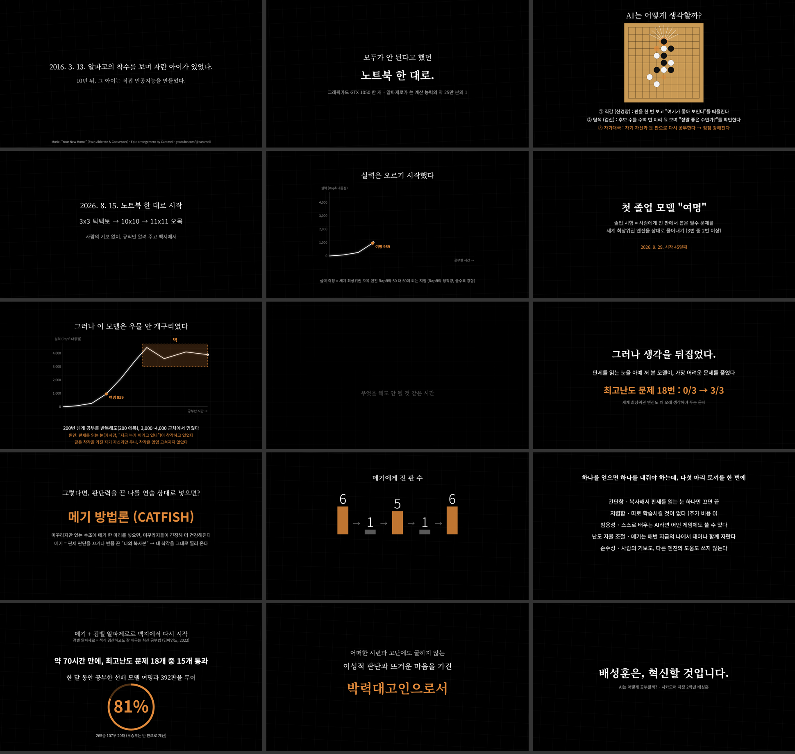
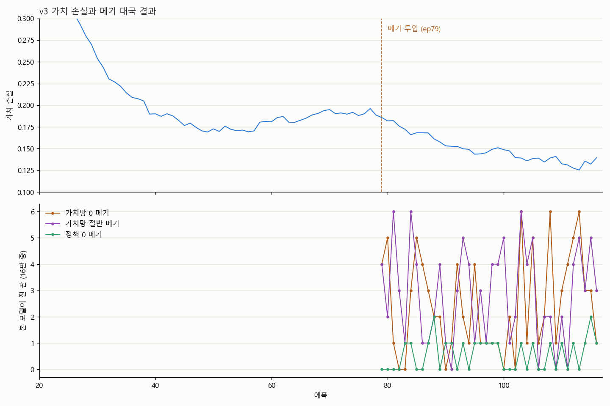
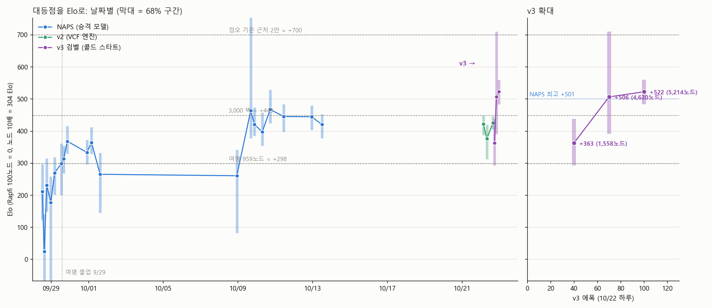

<div align="center">

# 🐟 omok-ai

### 노트북 한 대로 만든 11x11 오목 AlphaZero, 그리고 메기 방법론(CATFISH)

**AlphaZero 11x11 Gomoku trained on one laptop · CATFISH self-play anchors**


*2026. 8. 15. 시작 · 2026. 10. 28. 학교 축제 발표 및 시연*

</div>

---

## 한눈에 보기

> 알파제로가 쓴 계산 능력의 **약 25만 분의 1**(GTX 1050 노트북 한 대)로,
> 사람의 기보도 다른 엔진의 도움도 없이 백지에서 오목 AI를 학습시켰습니다.

| | |
|---|---|
| 🎓 **첫 졸업 모델 "여명"** (NAPS-625) | 2026. 9. 29. 졸업 문제 3/3 · Rapfi 대등점 959 노드 |
| 🧱 **벽** | 200 에폭 넘게 Rapfi 대등점 3,000~4,000에서 정체 |
| 🐟 **메기 방법론 (CATFISH)** | 가치망을 끄거나 반쯤 끈 *자기 복사본*을 자가대국 상대로 투입 |
| ⚡ **v3 (메기 + 검벨 알파제로)** | 백지에서 약 70시간 만에 최고난도 문제 **15/18** 통과 (정오, ep530) |
| 🏆 **선배 모델과 대결** | 정오 vs 여명 392판 **265승 107무 20패 (81%)** |
| 🎪 **축제 당일** | 관람객 대국 전승 |

<div align="center">
<br>
<sub>축제용 3분 요약 영상의 장면들 (<code>festival/intro_html/summary.html</code>에서 렌더링)</sub>
</div>

---

## AI는 어떻게 공부할까?

| 단계 | 하는 일 |
|---|---|
| **직감** (신경망) | 판을 보고 "여기가 좋아 보인다", "누가 이기고 있다"를 한 번에 떠올린다 |
| **탐색** (MCTS) | 후보 수를 수백 번 미리 둬 보며 정말 좋은 수인지 검산한다 |
| **자가대국** | 자기 자신과 둔 판을 기보로 쌓아 다시 공부한다 |

## 🧱 벽, 그리고 🐟 메기

자기 자신과만 두면 **판세 판단(가치망)의 착각이 상대에게도 똑같이 있어서** 고쳐지지 않습니다.
가치망을 아예 꺼 본 모델이 오히려 최고난도 문제 18번을 **0/3 → 3/3**으로 풀어낸 것에서 착안해,
판단력을 일부러 끈 복사본(메기)을 리그에 넣었습니다.

> 미꾸라지만 있는 수조에 메기 한 마리를 넣으면, 미꾸라지들이 긴장해서 더 건강해진다.

<div align="center">
<br>
<sub>메기 투입(ep79) 뒤 정체되던 가치 손실이 다시 내려가고, 메기에게 지고 → 고치기를 반복한다</sub>
</div>

**다섯 마리 토끼**

- **간단함** · 복사해서 판세를 읽는 눈 하나만 끄면 끝
- **저렴함** · 따로 학습시킬 것이 없다 (추가 비용 0)
- **범용성** · 스스로 배우는 AI라면 어떤 게임에도 쓸 수 있다
- **난도 자율 조절** · 메기는 매번 지금의 모델에서 새로 태어나 함께 자란다
- **순수성** · 사람의 기보도, 다른 엔진의 도움도 쓰지 않는다

## 📈 실력 측정

실력은 세계 최상위권 오목 엔진 [Rapfi](https://github.com/dhbloo/rapfi)와 **50 대 50이 되는 Rapfi의 탐색 노드 수(대등점)**로 잽니다. 클수록 강합니다.

<div align="center">
<br>
<sub>NAPS(왼쪽)는 3,000 근처에서 멈췄고, 메기 + 검벨 알파제로로 백지에서 다시 시작한 v3(오른쪽)는 ep100에서 이전 최고 기록을 넘었다 (막대 68%, 선 95% 신뢰구간)</sub>
</div>

<div align="center">

</div>

---

## 📁 구조

| 경로 | 내용 |
|---|---|
| `10x10/` | 11x11 본 프로젝트(폴더 이름은 역사적 이유). 학습기, MCTS, 자가대국 풀, 측정 도구, 웹 대국판 |
| `10x10/docs/` | 모델 계보(`NAPS_lineage.md`), 메기 보고서, 논문 자료 |
| `10x10/hlt/web/` | 웹 대국판 · 관전판 · 운영 대시보드 |
| `10x10/tactical_problems/` | 졸업 · 2단계 문제 (측정 전용, 학습에 쓰지 않음) |
| `11x11_v2/` | VCF 엔진 + MEGA + 메기 리그 실험 |
| `11x11_v2/v3/` | **v3: 검벨 알파제로 + 메기, 콜드 스타트** (`train_v3.py`, `net_v3.py`, C++ 엔진) |
| `15x15/` | 15x15 확장 실험 |
| `cpp_mcts/` | C++ MCTS 엔진과 depth-2 minimax 기준선 |
| `festival/` | 축제 영상 소스(HTML)와 렌더링 스크립트 |

포함하지 않은 것: 모델 가중치, 리플레이 버퍼, 로그, 컴파일된 바이너리, Rapfi, cloudflared,
같은 작업 폴더의 이전 3x3 / 5x5 프로젝트.

## ▶️ 주요 진입점

```text
학습 (v3)      11x11_v2/v3/train_v3.py
엔진 빌드      11x11_v2/v3/cpp/build_mcts_core_solver.bat   (MSVC + pybind11, Python 3.11)
측정           10x10/rapfi_ladder.py · 10x10/tactical_problem_check.py
웹 대국판      10x10/hlt/web/server.py      관전판  10x10/hlt/web/spectate.py
축제 영상      festival/render_summary.py   (Playwright로 프레임 단위 렌더링)
```

## 📜 라이선스

코드: MIT (`LICENSE` 참고).

사용했지만 포함하지 않은 서드파티:
- [Rapfi](https://github.com/dhbloo/rapfi) (GPL-3.0) — 측정 기준. 따로 내려받아 별도 프로세스로 실행하며,
  `rapfi_match.py`는 표준 Gomocup(Piskvork) 텍스트 프로토콜로 수만 주고받습니다.
  네트워크 가중치([rapfi-networks](https://github.com/dhbloo/rapfi-networks))는 CC0.
- PyTorch, pybind11 (BSD 계열).
- 축제 영상 음악: “Your New Home” (Evan Alderete & Gooseworx), Epic arrangement by Carameii — 음원 파일은 포함하지 않음.

<div align="center"><br>

**머리는 차갑게, 마음은 뜨겁게.**

<sub>배성훈 · 2026</sub>

</div>
