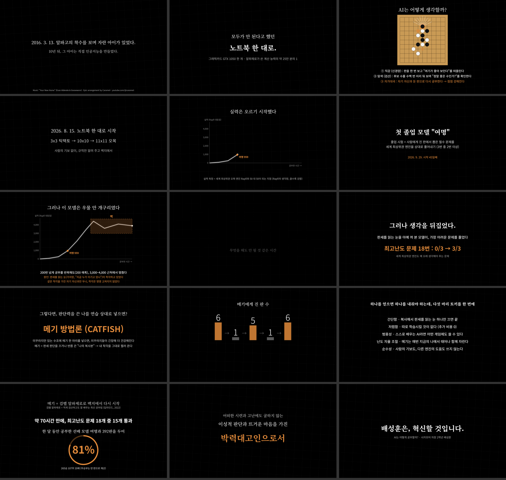
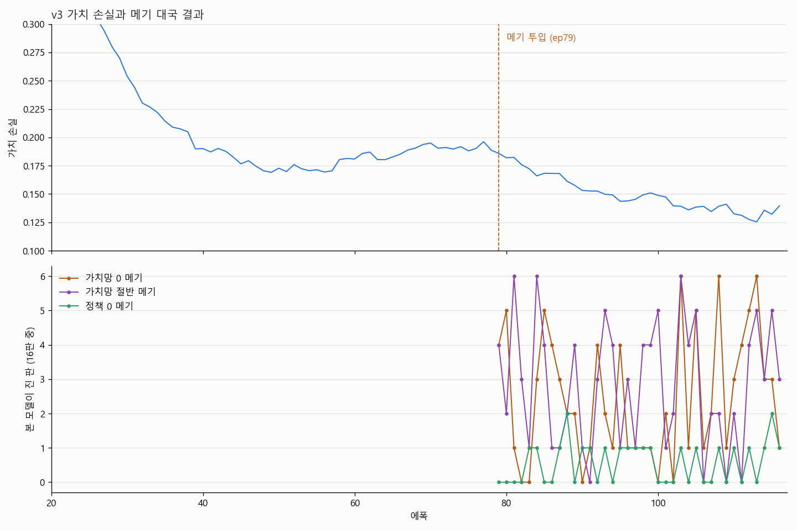
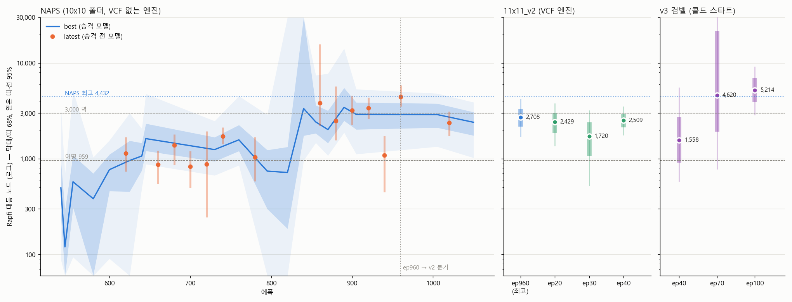
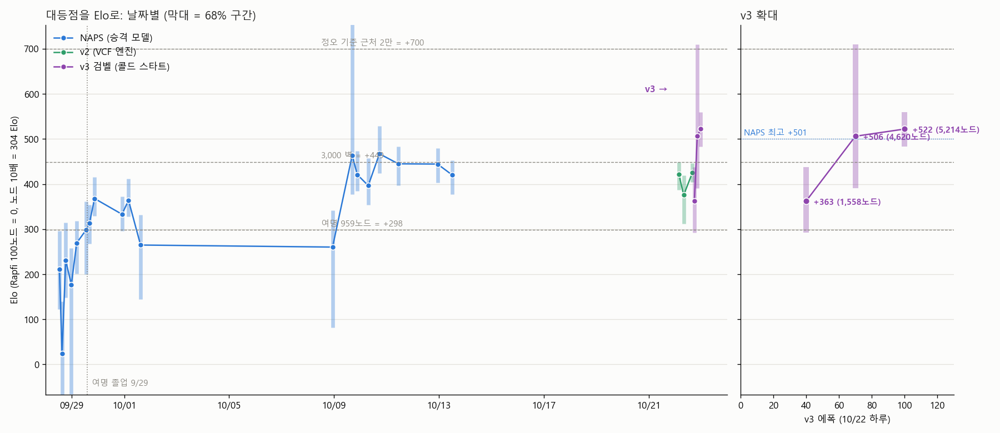

<div align="center">

# 🐟 omok-ai

### 고등학생 혼자, 2018년형 게이밍 노트북 한 대로<br>백지에서 키운 11x11 오목 AlphaZero, 그리고 메기 학습법(CATFISH)

**One high-school student · one 2018 laptop (GTX 1050, 4 GB VRAM) · no human games, no teacher engine · AlphaZero 11x11 Gomoku from scratch**

## [▶ 브라우저에서 바로 두기 · Play in your browser](https://baesunghu.github.io/omok-ai/)

<sub>설치 없음 · 신경망이 방문자의 브라우저 안에서 돌아갑니다 (WebGPU / WASM). VCF(연속 4 공격) 탐색 포함 · 탐색 횟수가 적은 경량판이라 PC 버전보다는 약합니다.</sub>


*2026. 8. 15. 시작 · 2026. 10. 28. 학교 축제 발표 및 시연*

</div>

---

## 한눈에 보기

> 알파제로가 쓴 계산 능력의 **약 25만 분의 1**(GTX 1050 노트북 한 대)로,
> 사람의 기보도 다른 엔진의 도움도 없이 백지에서 오목 AI를 학습시켰습니다.

### 🔧 이 환경에서 만들었습니다

| | 이 프로젝트 | 참고: AlphaZero (DeepMind, 2017) |
|---|---|---|
| 사람 | **고등학생 1명** (학업과 병행, 시험 기간 포함) | 연구팀 |
| 하드웨어 | **2018년형 게이밍 노트북 1대** — GTX 1050 (4 GB), i5-8300H | TPU 5,000개로 자가대국 |
| 연구비 | **0원** (가정용 전기) | — |
| 학습 데이터 | 자가대국만 (사람 기보 0판, 외부 엔진 도움 0) | 자가대국만 |
| GPU 온도 | 학습 내내 **90°C 안팎** | — |

메모리 4 GB에 맞추려고 신경망을 2.7M 파라미터로 줄이고, 파이썬이 느린 탐색은 C++로 다시 짜고,
하루에 돌릴 수 있는 실험이 한두 개뿐이라 실험마다 예측을 미리 적어 두고 시작했습니다.

| | |
|---|---|
| 🎓 **첫 졸업 모델 "여명"** (NAPS-625) | 2026. 9. 29. 졸업 문제 3/3 · Rapfi 대등점 959 노드 |
| 🧱 **벽** | 200 에폭 넘게 Rapfi 대등점 3,000~4,000에서 정체 |
| 🐟 **메기 학습법 (CATFISH)** | 가치망을 끄거나 반쯤 끈 *자기 복사본*을 자가대국 상대로 투입 → 통제 실험 결과 **현재 테스트한 규모에서는 효과 없음** |
| ⚡ **v3 (메기 + 검벨 알파제로)** | 백지에서 약 70시간 만에 최고난도 문제 **15/18** 통과 (정오, ep530) |
| 🏆 **선배 모델과 대결** | 정오 vs 여명 392판 **265승 107무 20패 (81%)** |
| 🎪 **축제 당일** | 관람객 대국 전승 |

<div align="center">
<br>
<sub>축제용 3분 요약 영상의 장면들 (<code>festival/intro_html/summary.html</code>에서 렌더링)</sub>
</div>

---

## AI는 어떻게 공부할까?

| 단계 | 하는 일 |
|---|---|
| **직감** (신경망) | 판을 보고 "여기가 좋아 보인다", "누가 이기고 있다"를 한 번에 떠올린다 |
| **탐색** (MCTS) | 후보 수를 수백 번 미리 둬 보며 정말 좋은 수인지 검산한다 |
| **자가대국** | 자기 자신과 둔 판을 기보로 쌓아 다시 공부한다 |

## 🧱 벽, 그리고 🐟 메기

자기 자신과만 두면 **판세 판단(가치망)의 착각이 상대에게도 똑같이 있어서** 고쳐지지 않습니다.
가치망을 아예 꺼 본 모델이 오히려 최고난도 문제 18번을 **0/3 → 3/3**으로 풀어낸 것에서 착안해,
판단력을 일부러 끈 복사본(메기)을 리그에 넣었습니다.

> 미꾸라지만 있는 수조에 메기 한 마리를 넣으면, 미꾸라지들이 긴장해서 더 건강해진다.

<div align="center">
<br>
<sub>메기 투입(ep79) 뒤 정체되던 가치 손실이 다시 내려가고, 메기에게 지고 → 고치기를 반복한다 (통제 실험 전의 관찰. 메기가 원인이라는 증거는 아래 검증에서 나오지 않았다)</sub>
</div>

**다섯 마리 토끼** (설계상의 성질입니다. 학습 효과와는 별개이며, 효과는 아래 검증에서 나타나지 않았습니다)

- **간단함** · 복사해서 판세를 읽는 눈 하나만 끄면 끝
- **저렴함** · 따로 학습시킬 것이 없다 (추가 비용 0)
- **범용성** · 스스로 배우는 AI라면 어떤 게임에도 쓸 수 있다
- **난도 자율 조절** · 메기는 매번 지금의 모델에서 새로 태어나 함께 자란다
- **순수성** · 사람의 기보도, 다른 엔진의 도움도 쓰지 않는다

## 📈 실력 측정

실력은 세계 최상위권 오목 엔진 [Rapfi](https://github.com/dhbloo/rapfi)와 **50 대 50이 되는 Rapfi의 탐색 노드 수(대등점)**로 잽니다. 클수록 강합니다.

<div align="center">
<br>
<sub>NAPS(왼쪽)는 3,000 근처에서 멈췄고, 메기 + 검벨 알파제로로 백지에서 다시 시작한 v3(오른쪽)는 ep100에서 이전 최고 기록을 넘었다 (막대 68%, 선 95% 신뢰구간)</sub>
</div>

<div align="center">

</div>

## 🧪 검증 결과: 현재 테스트한 규모에서는 효과 없음 (2026. 11.)

메기를 넣은 v3가 강해진 것만으로는 메기 덕분인지 알 수 없어서, **메기만 다르고 나머지는 모두 같은** 통제 실험을 했습니다.

- 같은 코드, 같은 초기 가중치(시드 고정), 차이는 메기 설정 한 줄
- 결과를 보기 전에 예측과 판정 기준을 파일로 기록하고 지문(SHA-256)을 남김 (사전 등록)
- 판정 기준: 시드 1~3 합산 직접 대결에서 메기 쪽 점수의 95% 신뢰구간 하한이 50% 초과

| 실험 | 메기 쪽 점수 (60 에폭 직접 대결) |
|---|---|
| 시드 1 | 58.8% (200판, 96승 43무 61패) |
| 시드 2 | 43.0% (150판) |
| 시드 3 | 44.5% (200판) |
| **합계 550판** | **49.3%** (95% 구간 약 46~53%) → **효과 없음** |

추가로 확인한 것 (사전 등록 판정에는 쓰지 않음):

- 메기를 **더 세게** 하면 오히려 나빠짐 (42.5%)
- 70 에폭 모델에서 분기해 이어 학습해도 차이 없음 (51.5%)
- 정체기 확인 P (11/03): 본 학습 ep543에서 분기해 27 에폭 추가 학습 → ep570 직접 대결 200판 메기 쪽 48.0%, 가치 착각 교정·전술 테스트도 차이 없음. 착취 견고성(맹점) 측정은 공격자 학습이 성립하지 않아 판정 보류
- 재검증 (11/11): 시드 1~3 체크포인트, 이전에 쓰지 않은 새 시작 위치로 추가 대국을 사전 등록(목표 1,350판). 약 460판에서 중단, 합산 메기 쪽 49.3%로 다시 50%와 구별되지 않음 (부분 결과). 메기 비중 50% 학습(K50)도 ep5에서 중단
- 가치망에 일부러 착각을 심어도 **자가대국만으로 1~10 에폭 만에 회복** → 2인 대국에서는 진 쪽 수에 매번 −1이 붙어 착각이 오래 숨지 못함
- 메기 대국이 새 국면으로 데려가는 정도(+4.6%p)는 이미 쓰고 있는 무작위 오프닝보다 훨씬 작음

> **결론: 현재 테스트한 규모(11x11, 128x8 신경망, 60 에폭, 시드 3쌍)에서는 효과 없음.**
> 이 규모에서는 메기가 하려던 일을 자가대국이 이미 혼자 잘하고 있었습니다.
> 더 큰 판, 더 큰 신경망, 더 긴 학습, 더 많은 시드에서는 시험하지 않았습니다. 이 결과를 끝으로 메기 연구를 종료했습니다(2026-11-11).
> 자세한 내용: [`docs/CATFISH_report.md`](docs/CATFISH_report.md) 9~10장

---

## 🤝 AI 도구를 어떻게 썼는가

이 프로젝트는 **AI 코딩 도구(Anthropic의 Claude, Claude Code)와 함께** 만들었습니다. 무엇을 누가 했는지 사실대로 적습니다.

**AI 도구가 한 일**
- 코드 작성과 수정(학습 루프, C++ 탐색 엔진, 대국·평가 스크립트, 웹 데모 포팅 등)
- 실험 실행 보조: 스크립트 실행, 로그 확인, 결과 집계, 표와 그래프 작성
- 문서 초안(사전 등록 문서, 기록 정리)과 결과 해석에 대한 토론 상대

**사람(저자)이 한 일**
- 무엇을 검증할지 정하는 일: 메기 학습법 아이디어, 11x11로의 복귀, 대조군을 처음부터 다시 학습하는 설계 선택
- 판정 기준과 시드·판 수를 결과를 보기 전에 정하고, 그대로 지킨 것
- 결과가 기대와 달라도 "효과 없음"으로 닫고, 사후에 만든 변형은 탐색 결과로 구분한 것
- 어떤 실험을 언제 멈출지 결정한 것 (이 저장소의 중단 결정은 모두 저자의 지시)
- 환경(한 대의 노트북 GPU)과 비용 제약 아래서 우선순위를 정하는 일

**한계**
- AI 도구가 작성한 코드는 모든 줄을 저자가 직접 검토하지는 않았습니다. 중요한 수치는 로그와 재측정으로 확인했지만, 코드 오류의 가능성은 남아 있습니다.
- 결과 해석과 문장 표현에는 AI 도구의 도움이 들어 있습니다.

---

## 📁 구조

| 경로 | 내용 |
|---|---|
| [`docs/`](docs/README.md) | **모든 문서**: 결론, 모델 계보(`NAPS_lineage.md`), 메기 보고서(`CATFISH_report.md`), 실험 기록, 보관 문서, 용어 |
| `omok_paths.py` | 경로 설정 한 곳 (저장소 루트, Rapfi·scratch 위치는 환경 변수로 변경) |
| [`shared/`](shared/README.md) | **모든 실행에 공통인 코드 한 벌**: 신경망, MCTS, 자가대국, 래더 측정과 분석 도구. 세 실행 폴더에 똑같이 복사되어 있던 파일을 모음 |
| `10x10/` | 11x11 NAPS 실행 폴더(이름은 역사적 이유). 이 실행만의 학습 본체·학습 실행·감시·채점, 웹 대국판 |
| `10x10/hlt/web/` | 웹 대국판 · 관전판 · 운영 대시보드 |
| `10x10/tactical_problems/` | 졸업 · 2단계 문제 (측정 전용, 학습에 쓰지 않음) |
| `11x11_v2/` | VCF 엔진 + MEGA + 메기 리그 실험 |
| `11x11_v2/v3/` | **v3: 검벨 알파제로 + 메기, 콜드 스타트** (`train_v3.py`, `net_v3.py`, C++ 엔진), 통제 실험 팔 설정 `arms.py` |
| `11x11_v2/kaggle/` | 통제 실험을 Kaggle GPU에서 돌린 실행기 |
| `11x11_v2/web/` | 브라우저 대국판 (`site/`) 과 ONNX 내보내기 스크립트 |
| `15x15/` | 15x15 확장 실험 (실행 폴더) |
| [`archive/`](archive/README.md) | 한 번 쓰고 끝난 스크립트 (기록용) |
| `cpp_mcts/` | C++ MCTS 엔진과 depth-2 minimax 기준선 |
| `festival/` | 축제 영상 소스(HTML)와 렌더링 스크립트 |

포함하지 않은 것: 학습 체크포인트, 리플레이 버퍼, 로그, 컴파일된 바이너리, Rapfi, cloudflared,
같은 작업 폴더의 이전 3x3 / 5x5 프로젝트.
예외: 브라우저 대국판용 v3(ep543) 모델 `naps_v3.onnx`는 [`gh-pages` 브랜치](https://github.com/baesunghu/omok-ai/tree/gh-pages)에 공개되어 있습니다.

## ▶️ 주요 진입점

```text
학습 (v3)      11x11_v2/v3/train_v3.py              통제 실험 팔: 11x11_v2/v3/train_v3.py B_catfish_s2
엔진 빌드      11x11_v2/v3/cpp/build_mcts_core_solver.bat   (MSVC + pybind11, PATH의 python 사용)
측정           cd 10x10 && python ../shared/rapfi_ladder.py   (shared/의 도구는 다룰 실행 폴더 안에서 실행)
채점           10x10/tactical_problem_check.py
웹 대국판      10x10/hlt/web/server.py      관전판  10x10/hlt/web/spectate.py
축제 영상      festival/render_summary.py   (Playwright로 프레임 단위 렌더링)
경로 설정      omok_paths.py                (Rapfi: OMOK_RAPFI_DIR, 기본값 engines/rapfi/)
판 크기        각 실행 폴더의 fast_board.py  (BOARD_SIZE, 파일 이름 접미사 FILE_SUFFIX)
```

## 📜 라이선스

코드: MIT (`LICENSE` 참고).

사용했지만 포함하지 않은 서드파티:
- [Rapfi](https://github.com/dhbloo/rapfi) (GPL-3.0) — 측정 기준. 따로 내려받아 별도 프로세스로 실행하며,
  `rapfi_match.py`는 표준 Gomocup(Piskvork) 텍스트 프로토콜로 수만 주고받습니다.
  네트워크 가중치([rapfi-networks](https://github.com/dhbloo/rapfi-networks))는 CC0.
- PyTorch, pybind11 (BSD 계열).
- 축제 영상 음악: “Your New Home” (Evan Alderete & Gooseworx), Epic arrangement by Carameii — 음원 파일은 포함하지 않음.

<div align="center"><br>

**머리는 차갑게, 마음은 뜨겁게.**

<sub>배성훈 · 2026</sub>

</div>
