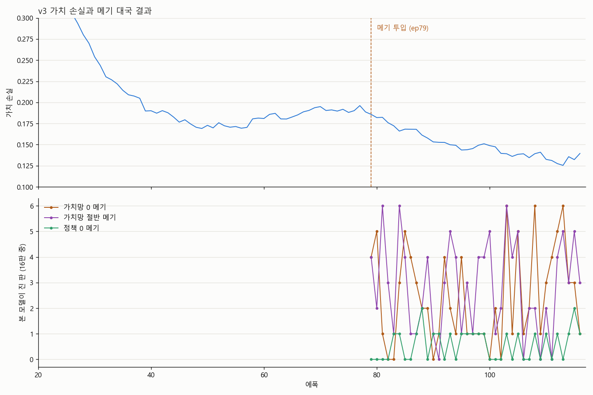
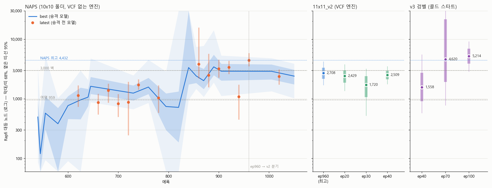

# A high-school student, a 2018 laptop, and an AlphaZero for Gomoku built from zero

> **About this text:** I'm a Korean high-school student. This post was written with an AI assistant (Claude) from my own story, notes and experiment logs. The project itself was also built with heavy AI help ("vibe coding") — the ideas, the decisions, and the late nights were mine.

**👉 Play it first if you like: [play in your browser](https://baesunghu.github.io/omok-ai/)** — no install; the neural network runs inside your browser.

---

## How it started

I was amazed the first time I watched AlphaGo play. I kept reading about it, but back then I was a middle-school student with no programming skills, so watching was all I could do.

In high school, "vibe coding" (building software by describing it to an AI) became popular. I tried it on the smallest possible version of the idea: a **tic-tac-toe** AI that learns only by playing itself. It worked. So in August 2026 I scaled it up to **11x11 Gomoku** (five in a row).

## The setup

| | This project | For reference: AlphaZero (DeepMind, 2017) |
|---|---|---|
| People | **1 high-school student** (during the school year, including exams) | a research team |
| Hardware | **one 2018 gaming laptop** — GTX 1050 (4 GB), i5-8300H | 5,000 TPUs for self-play |
| Budget | **$0** (household electricity) | — |
| Training data | self-play only — 0 human games, no help from other engines | self-play only |
| GPU temperature | **~90 °C** for weeks | — |

Roughly 1/250,000 of AlphaZero's compute. That's why the board is 11x11 instead of Go's 19x19.

To fit in 4 GB the network is small (2.7M parameters, 128 channels x 8 residual blocks), and the hot search loop was rewritten in C++. With only one or two experiments per day possible, I started writing down predictions *before* each run.

## How strength is measured

Against [Rapfi](https://github.com/dhbloo/rapfi), one of the strongest Gomoku engines. I limit Rapfi's search nodes and find the node count where my AI scores 50% (the "equal point"). Higher is stronger.

## The wall, and the "catfish"

After my first "graduated" model, the equal point stalled at 3,000-4,000 Rapfi nodes for over 200 epochs. My diagnosis: in pure self-play, the value network's misjudgments are shared by the opponent — which is itself — so nobody punishes them.

The hint came from an odd result: a copy with the value head switched **off** solved a hard puzzle the full model kept failing.

So I tried this, and named it **CATFISH training** (메기 학습법):

> Every epoch, copy the *current* network, cripple it (value head zeroed or halved, or policy flattened), and mix games against these "catfish" into self-play.

The name comes from a Korean saying: put a catfish into a tank of loaches and the loaches stay lively. Catfish cost nothing to train, and because they are rebuilt from the current model every epoch, they grow with it. It's close in spirit to AlphaStar's exploiters, but much cheaper — no separate agent is trained.

## v3: catfish + Gumbel AlphaZero, from scratch

Combining catfish with Gumbel AlphaZero, I retrained from a blank network:

- ~70 hours to pass **15/18** of the hardest tactical puzzles
- vs. my previous best model: **265 wins, 107 draws, 20 losses** over 392 games (81%)
- shown at my school festival on Oct 28 — it won every game against visitors

## But was it really the catfish?

Honestly, **I don't know yet** — it could be Gumbel AlphaZero, or luck. So I'm testing it properly:

- same code, same initial weights (fixed seed); the only difference is one config line that turns catfish on or off
- predictions and pass/fail criteria are written down *before* results, and each file's SHA-256 is logged (a small pre-registration)
- three seeds; the verdict is the confidence interval over all 600 games combined

First seed: in a 200-game head-to-head at epoch 60, the catfish model scored **58.8%** (96 W / 43 D / 61 L). That's one run, so it's not a conclusion. The other seeds finish this week, and I'll publish the result **whichever way it goes**.

## Try it

The web version runs the network **in your browser** (ONNX Runtime Web, WebGPU or WASM) with a VCF (continuous-four) solver. It searches less than the PC version, so it's a bit weaker.

- 🎮 Play: https://baesunghu.github.io/omok-ai/
- 💻 Code: https://github.com/baesunghu/omok-ai

If you beat it, I'd love to hear how. 🐟

---

*Sunghun Bae · high-school student, Korea · 2026 · written with help from Claude (AI)*
