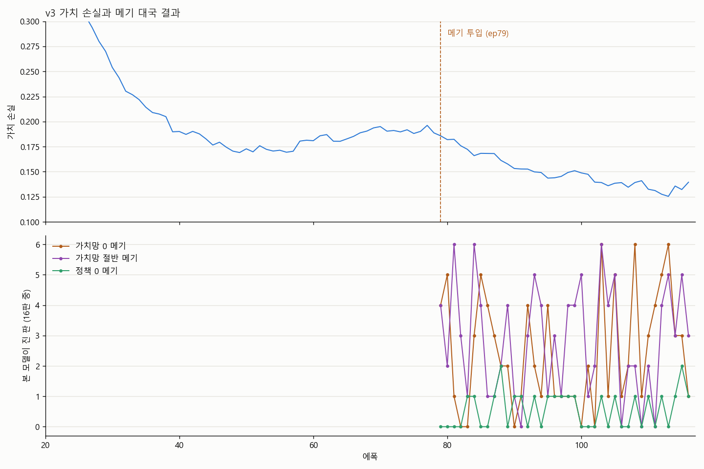
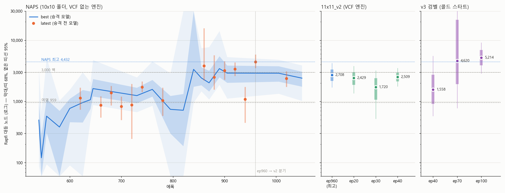

# 고등학생이 2018년형 노트북 한 대로 오목 AI를 백지에서 키운 기록

**👉 먼저 한 판 두고 오셔도 됩니다: [브라우저에서 바로 두기](https://baesunghu.github.io/omok-ai/)**
(설치 없이, AI가 여러분의 브라우저 안에서 직접 생각합니다.)

---

## 시작: 알파고, 그리고 틱택토

처음 놀란 건 알파고가 바둑 두는 걸 봤을 때였습니다.
그 뒤로도 틈틈이 찾아보며 공부했지만, 그때 저는 개발 실력도 없는 중학생이었습니다. 보는 것 말고는 할 수 있는 게 없었죠.

고등학교에 와 보니 **바이브 코딩**(AI에게 말로 설명하면서 함께 코드를 짜는 방식)이 유행하고 있었습니다.
"이걸로 알파고 비슷한 걸 만들 수 있을까?" 하고 시험 삼아 **틱택토(3x3)** AI부터 만들어 봤습니다.
자기 자신과 두면서 스스로 강해지는 게 실제로 동작하는 걸 보고, *이건 더 키울 수 있겠다* 싶어 2026년 8월에 오목으로 판을 키웠습니다.

제 장비는 이렇습니다.

| | |
|---|---|
| 노트북 | 2018년형 게이밍 노트북 |
| GPU | GTX 1050, 메모리 4 GB |
| CPU | i5-8300H |
| 연구비 | 0원 |
| 시간 | 학교 다니면서 (중간에 시험 기간 2주 포함) |

알파제로가 자가대국에 쓴 TPU가 5,000개였으니, 계산 능력으로 치면 대략 **25만 분의 1**입니다.
그래서 바둑 대신 **11x11 오목**을 골랐습니다. 판이 작아야 이 노트북으로 승부가 됩니다.

## AI는 어떻게 공부할까?

원리는 세 가지가 전부입니다.

1. **직감 (신경망)** — 판을 보고 "여기가 좋아 보인다", "누가 이기고 있다"를 한 번에 떠올립니다.
2. **검산 (탐색, MCTS)** — 후보 수를 수백 번 미리 둬 보며 정말 좋은 수인지 확인합니다.
3. **복습 (자가대국)** — 자기 자신과 둔 판을 기보로 쌓고, 그걸로 다시 직감을 고칩니다.

처음엔 돌을 아무 데나 두던 AI가 학습이 쌓일수록 4를 막고, 3을 만들고, 함정을 피하기 시작합니다.
이걸 지켜보는 게 이 프로젝트에서 제일 재밌는 부분이었습니다.

## 노트북 한계와 싸운 방법

- **메모리 4 GB** → 신경망을 270만 파라미터로 작게 설계했습니다.
- **파이썬이 느림** → 가장 많이 도는 탐색 부분을 C++로 다시 짰습니다.
- **GPU 90°C** → 학습 내내 이 온도였습니다. 노트북에게 미안합니다.
- **하루에 실험 한두 개** → 실험을 함부로 돌릴 수 없어서, 결과를 보기 전에 "이렇게 나올 것이다"를 먼저 적어 두는 습관이 생겼습니다.

실력은 세계 최상위권 오목 엔진 [Rapfi](https://github.com/dhbloo/rapfi)를 기준으로 잽니다.
Rapfi의 탐색 노드 수를 조절해 가며 **50 대 50이 되는 지점(대등점)**을 찾는 방식입니다. 이 숫자가 클수록 강합니다.

## 벽

첫 졸업 모델 "여명"까지는 순조로웠습니다. 그런데 그다음 200 에폭이 넘도록 대등점이 **3,000~4,000 노드**에서 꿈쩍도 하지 않았습니다.

원인을 파 보니, 자기 자신과만 두면 **판세를 잘못 읽는 버릇이 상대(=자기 자신)에게도 똑같이 있어서** 그 착각이 끝까지 안 고쳐진다는 것이었습니다.
같은 착각을 하는 두 사람이 서로를 가르칠 수는 없으니까요.

## 메기 학습법 (CATFISH)

힌트는 이상한 곳에서 왔습니다. 판세를 읽는 부분(가치망)을 **아예 꺼 버린** 모델이, 원래 모델이 못 풀던 최고난도 문제를 오히려 풀어낸 겁니다.

그래서 이렇게 해 봤습니다.

> 매 학습 단계마다 **현재 모델을 복사해서, 판세 판단을 끄거나 반쯤 끈 "메기"**를 만들고, 자가대국에 섞는다.

미꾸라지만 있는 수조에 메기 한 마리를 넣으면 미꾸라지들이 긴장해서 더 건강해진다는 이야기에서 이름을 따왔습니다.
메기는 따로 학습시킬 필요가 없어서 **추가 비용이 0**이고, 매번 지금의 모델에서 새로 태어나기 때문에 **본체와 함께 자랍니다.**

## v3: 메기 + 검벨 알파제로, 백지에서 다시

메기와 검벨 알파제로(Gumbel AlphaZero, 적은 탐색으로도 잘 배우는 개선판)를 합쳐 처음부터 다시 학습했습니다.

- 약 70시간 만에 최고난도 문제 18개 중 **15개** 통과
- 이전 최고 모델 "여명"과 392판: **265승 107무 20패 (81%)**
- 10월 28일 학교 축제에서 관람객들과 대국, **전승**

## 그런데, 정말 메기 덕분일까? → 아니었습니다

처음에는 v3가 강해진 게 메기 덕분인지, 검벨 알파제로 덕분인지, 그냥 운인지 몰랐습니다. 그래서 제대로 검증했습니다.

- 같은 코드, 같은 초기값, **메기만 넣고 뺀** 두 모델을 따로 학습
- 결과를 보기 전에 예측과 판정 기준을 파일로 적고, 고칠 수 없도록 지문(SHA-256)을 남김
- 시드를 바꿔 세 번 반복하고, 합친 결과로 판정

**결과: 메기는 효과가 없었습니다.**

| 시드 | 메기 쪽 점수 (60 에폭 직접 대결) |
|---|---|
| 1 | 58.8% |
| 2 | 43.0% (150판) |
| 3 | 44.5% |
| **합계 550판** | **49.3%** (95% 구간 약 46~53%) |

첫 실험의 58.8%는 운이었습니다. 미리 정해 둔 기준(합산 구간의 하한이 50% 초과)을 넘지 못했으니, 약속대로 **"효과 없음"**으로 판정합니다.

그 뒤로 "왜 안 되지?"를 하루 종일 파 봤습니다.

- 메기를 **더 세게** 하면 오히려 나빠졌습니다 (42.5%).
- 모델에 일부러 착각을 심어 봤더니, **자가대국만으로 1~10 에폭 만에 고쳐졌습니다.** 2인 대국에서는 진 쪽의 수에 매번 "틀렸다"는 표시가 붙기 때문에, 착각이 오래 숨어 있을 수가 없습니다.
- 메기가 새로운 국면으로 데려가기는 했지만(+4.6%p), 이미 넣어 둔 무작위 오프닝이 훨씬 더 많은 새 국면을 만들고 있었습니다.

정리하면, **메기가 하려던 일을 자가대국이 이미 혼자서 잘하고 있었습니다.** 판이 더 넓거나, 오래 학습해서 굳은 모델이라면 다를 수도 있어서 그 실험은 계속하고 있습니다. 하지만 지금 이 규모에서의 답은 "효과 없음"입니다.

아이디어가 틀렸다는 걸 확인하는 것도 연구라고 생각합니다. 기대와 다른 결과라도 미리 정한 기준대로 판정하는 경험을 했습니다.

## 직접 둬 보세요

웹 버전은 서버 없이 **여러분의 브라우저에서 신경망이 직접 돌아갑니다.** (경량판이라 PC 버전보다는 약합니다.)

- 🎮 대국: https://baesunghu.github.io/omok-ai/
- 💻 코드: https://github.com/baesunghu/omok-ai

이기셨다면 댓글로 자랑해 주세요. 지셨다면… 그것도 알려 주세요. 🐟

---

*배성훈 · 고등학생 · 2026*
